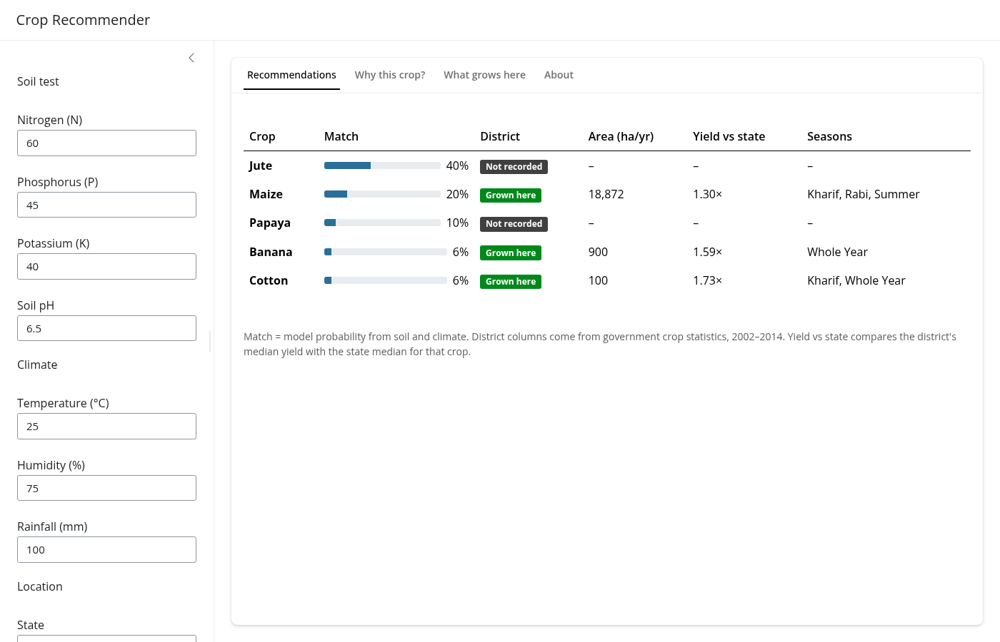
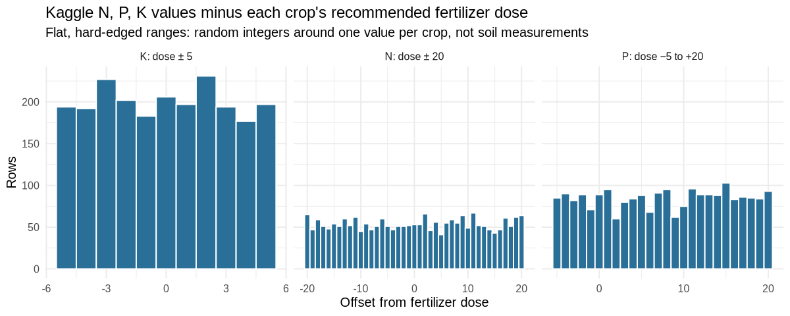
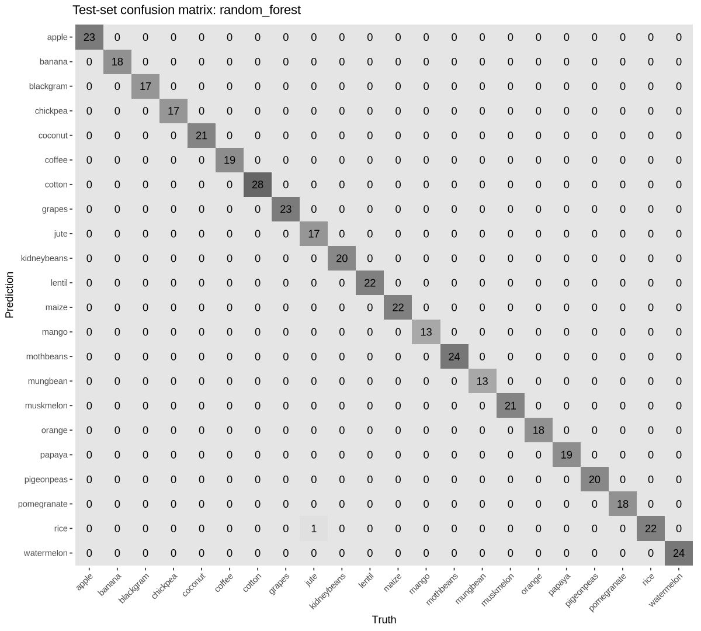
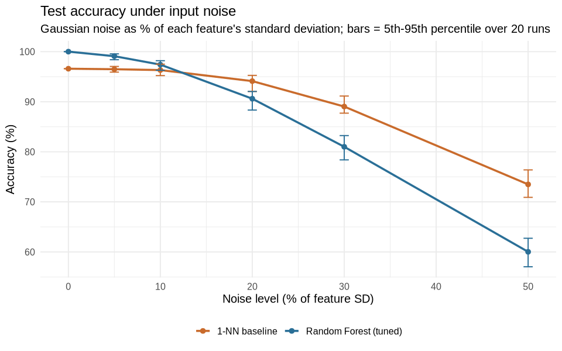
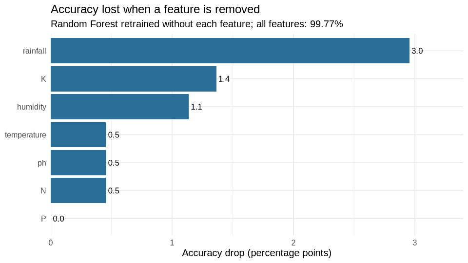
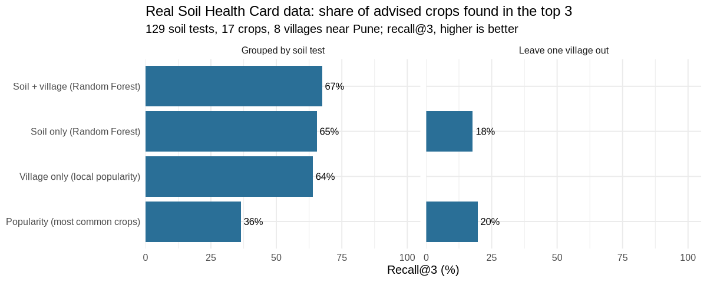

<!-- markdownlint-disable MD013 -->
<!-- markdownlint-disable MD060 -->
# Intelligent Crop Recommendation System (ICRS)

Recommends crops from soil nutrients (N, P, K, pH) and climate (temperature, humidity, rainfall), using R.

Most projects built on the popular Kaggle crop dataset report about 99% accuracy. This project asks
whether that number means anything. It audits the benchmark, evaluates models honestly, and tests them
on real Indian Soil Health Card data.

## Status

| Stage | Status |
|---|---|
| Data audit, cleaning and outlier analysis | Done |
| Provenance audit of the Kaggle data | Done |
| Model benchmark with stratified cross-validation | Done |
| Robustness tests (noise, feature ablation) | Done |
| Explainability (SHAP) | Planned |
| Validation on real Soil Health Card data | Done |
| Soil clustering (k-means and PCA) | Planned |
| Shiny web app | Built (deployment pending) |

## Web app

A Shiny app ([`app/`](app/)) that combines the soil and climate model with real district crop statistics:

- ranks crops from 7 soil and climate readings, with match probabilities
- shows whether each crop is actually grown in your district, its area, and its yield compared with the state
- warns when readings are unlike anything in the training data
- explains each crop: which of your readings fall inside or outside its typical range



Run it locally from the repository root:

```sh
Rscript app/prepare_data.R                   # builds app/data/ (model + district statistics)
Rscript -e 'shiny::runApp("app")'
```

Deploy to shinyapps.io: see [`app/deploy.R`](app/deploy.R).

## Data

- **Main:** the [Kaggle Crop Recommendation dataset](https://www.kaggle.com/datasets/atharvaingle/crop-recommendation-dataset). It has 2,200 rows, 22 crops (100 each), 7 numeric features and a `label` column.
- **Test copy with injected defects:** `dataset/Crop_recommendation.csv` has 2,714 rows: the original 2,200 unchanged, plus 507 extra copies of 4 rice rows and 7 copies of rice rows with `P` blanked out. The defects give the cleaning stage real problems to catch.
- **Source files of the Kaggle dataset** (`dataset/external/harvestify/`): the original CSV, the climate table and the per-crop fertilizer table it was built from, taken from its author's [Harvestify](https://github.com/Gladiator07/Harvestify) repository.
- **Indian district crop production** (`dataset/external/india_crop_production.csv.gz`): 246,091 real records of area and production covering 33 states, 646 districts, 124 crops and 1997–2015.
- **Real Soil Health Card data** (`dataset/external/soil_health_card/`): [Soil Nutrient Dataset for Crop Advice](https://data.mendeley.com/datasets/6n3jjhncbp) (CC BY 4.0). It has 1,651 usable rows covering 129 soil tests from 8 villages near Pune, 11 soil features (pH, organic carbon and N as numbers; the rest as low-to-high categories) and 17 advised crops.

## Running

Run the scripts from the repository root:

```sh
Rscript dataset_cleaning/datasetClean.R      # -> dataset/Crop_recommendation_cleaned.csv
Rscript dataset_outlier/outlier_detect.R     # IQR outlier report
Rscript dataset_outlier/outlier_managing.R   # -> dataset/Outlier_removed.csv (analysis only, see below)
Rscript dataset_stats/DataExploration.R      # summary statistics
Rscript modelling/provenance_audit.R         # how the Kaggle data was generated
Rscript modelling/benchmark.R                # -> modelling/results/ (a few minutes on a multi-core machine)
Rscript modelling/stress_test.R              # noise and feature-ablation tests (needs benchmark first)
Rscript modelling/soil_health_card.R         # validation on real Soil Health Card data
```

## Phase 1 results

### Cleaning

The cleaning script (`dataset_cleaning/datasetClean.R`) runs in this order:

1. Remove the 507 exact duplicates (18.68%).
2. Remove the 7 rows with a missing `P`. Each one matches a complete row on every other column, so it is a damaged copy, not a new sample.
3. Fill any value that is still missing with that crop's median. None remained in this data.

The order matters. Filling in values first would turn the damaged copies into new-looking rows that survive
de-duplication. An earlier version did this and left rice with 107 rows instead of 100.

Result: **2,200 rows, 100 per crop, no missing values.** Full log: [`dataset_cleaning/datasetCleaned.txt`](dataset_cleaning/datasetCleaned.txt).

### Outliers: detected, kept

The IQR rule (1.5 × IQR) flags many values in 6 of the 7 features:

| Feature | Flagged values | Normal range (IQR rule) |
|---|---|---|
| K | 200 | -23.5 to 92.5 |
| P | 138 | -32 to 128 |
| Rainfall | 100 | -25.0 to 213.8 mm |
| Temperature | 86 | 14.1 to 37.3 °C |
| pH | 57 | 4.54 to 8.35 |
| Humidity | 30 | 15.7 to 134.5 % |
| N | 0 | -73.9 to 179.1 |

Removing every flagged row would cut the data from 2,200 to 1,768 rows (-19.6%). Two whole crops, **apple and grapes, would disappear**, and rice would drop to 32 rows. These values are not errors: apple and grapes really need K of about 200, rice needs heavy rainfall, and chickpea grows at very low humidity.
So the outliers stay in the modelling data. `Outlier_removed.csv` is kept only to show this effect.
Logs: [`outliers.txt`](dataset_outlier/outliers.txt), [`outlier_output.txt`](dataset_outlier/outlier_output.txt).

### Benchmark audit: the soil values are not soil measurements

Script: [`modelling/provenance_audit.R`](modelling/provenance_audit.R). It uses the dataset author's own source files.

- **Climate is copied.** All 2,200 rows' temperature, humidity and rainfall appear verbatim in `cpdata.csv`.
- **N, P and K are random numbers around a fertilizer dose.** Each crop has one recommended dose in `FertilizerData.csv`,
  and every row is that dose plus a random whole number: N ± 20, P −5 to +20, K ± 5. The offsets are flat, consistent with a
  uniform distribution (chi-squared p = 0.78, 0.19, 0.20 for N, P, K).



So each crop sits in its own sharp-edged box of values (K for apple and grapes is always 195–205), and the box comes from a
fertilizer recommendation, not from any field. A 1-nearest-neighbour classifier with no tuning already scores **97.6%**
(leave-one-out, standardised features). High accuracy here is built into how the data was made, which is why this project
focuses on robustness and real data.
Other work supports this: [Sam & D'Abreo (2025)](https://arxiv.org/abs/2505.21201) report 99.96% with 10-fold CV, which drops to 78.55% with a time-based split.

### Model benchmark

Each model is tuned with 10-fold cross-validation on 80% of the cleaned data, then scored once on the held-out 20%.
Both the split and the folds are stratified by crop, so the test set has 20 rows of each crop (440 in total).
Script: [`modelling/benchmark.R`](modelling/benchmark.R). Results: [`modelling/results/`](modelling/results/).

| Model | CV accuracy (± SE) | Test accuracy | Test macro-F1 |
|---|---|---|---|
| Random Forest | **99.55% ± 0.17** | **100%** | 1.000 |
| XGBoost | 99.15% ± 0.23 | 99.77% | 0.998 |
| SVM (RBF kernel) | 98.92% ± 0.18 | 97.95% | 0.980 |
| Decision tree | 97.90% ± 0.29 | 98.86% | 0.989 |
| 1-NN baseline (no tuning) | 97.90% ± 0.24 | 96.59% | 0.966 |
| Multinomial logistic | 96.99% ± 0.28 | 97.50% | 0.975 |

A single 440-row test set is too small to tell 99.8% from 100% apart, so the cross-validated accuracy is the better
comparison. Random Forest beats the untuned 1-nearest-neighbour model by only 1.7 points in cross-validation. For k-NN,
cross-validation picked k = 1, so the baseline is already the best k-NN model.



### Stress tests

Script: [`modelling/stress_test.R`](modelling/stress_test.R) (about 30 seconds).

**Noise robustness.** Real soil tests and weather readings are noisy. Gaussian noise is added to the test inputs as a
percentage of each feature's standard deviation, repeated 20 times per level.

| Noise (% of SD) | Random Forest | 1-NN baseline |
|---|---|---|
| 0% | **100%** | 96.6% |
| 5% | **99.1%** | 96.5% |
| 10% | **97.4%** | 96.3% |
| 20% | 90.6% | **94.1%** |
| 30% | 81.0% | **89.0%** |
| 50% | 60.0% | **73.5%** |



**The best model on clean data is the least robust.** Above about 10% noise, the tuned Random Forest falls behind the
untuned 1-NN baseline, and the gap grows to 13.5 points at 50% noise. This fits the benchmark audit: each crop occupies
a narrow, sharp-edged box of values, and the forest learns those exact edges. A leaderboard score on clean data would
therefore pick the wrong model for field use.

**Feature ablation.** The Random Forest is retrained without each feature in turn. Rainfall is the hardest to replace
(-3.0 points). Removing P costs nothing, because P is closely tied to K in this data (correlation 0.74).
These runs refit `ranger` directly, without the normalisation step, so the all-features score is 99.77% rather than 100%.



### Real data: Soil Health Card records

Script: [`modelling/soil_health_card.R`](modelling/soil_health_card.R) (about 10 seconds).

This data has a different structure from Kaggle. Each soil test is repeated once for every crop it was advised for,
so 1,651 rows are really **129 soil tests, each with a set of 1–7 advised crops** (median 5). The task is to rank
suitable crops, not to predict one crop. Treating it as single-label caps accuracy at 24.8% and gives 5.8% in practice.
Models are scored on whether the advised crops appear in their top 3, with cross-validation grouped by soil test so that
no test is in both training and evaluation data.

| Evaluation | Model | Recall@3 | Precision@3 | Top pick correct |
|---|---|---|---|---|
| 10-fold CV, grouped by soil test | Most common crops overall | 36.4% | 50.4% | 58.9% |
| | Most common crops in the same village | 63.9% | 82.2% | 94.6% |
| | Soil only (Random Forest) | 65.4% | 84.2% | 91.5% |
| | Soil + village (Random Forest) | **67.5%** | **87.9%** | **94.6%** |
| Leave one village out | Most common crops overall | **19.6%** | **33.6%** | **42.6%** |
| | Soil only (Random Forest) | 17.8% | 29.2% | 28.7% |



**On real data, soil adds little beyond location.** Knowing only the village gets within 1.5 points of the soil model,
and on a village the model has never seen, soil does worse than recommending the most common crops. The advice in these
records is mostly local practice, and the soil values mainly identify the village. A useful recommender therefore has
to combine soil with local knowledge, such as which crops are actually grown and yield well in the district, instead of
treating soil readings as the whole answer. Kaggle's 99% does not carry over to real data.

### Exploratory analysis (raw data, before cleaning)


| Variable    | Mean   | SD     | Min   | Max    |
|-------------|--------|--------|-------|--------|
| N           | 54.07  | 34.25  | 0     | 140    |
| P           | 51.69  | 30.23  | 5     | 145    |
| K           | 46.98  | 45.67  | 5     | 205    |
| temperature | 25.41  | 4.66   | 8.83  | 43.68  |
| humidity    | 73.33  | 20.41  | 14.26 | 99.98  |
| ph          | 6.63   | 0.80   | 3.50  | 9.94   |
| rainfall    | 131.08 | 75.93  | 20.21 | 298.56 |


| Humidity | Rainfall |
|---|---|
|  |  |
| **pH** | **Temperature** |
|  |  |


## Project structure

```text
dataset/            raw, cleaned and outlier-removed CSVs
dataset/external/   Kaggle source files, real Soil Health Card data, real crop production data
dataset_cleaning/   de-duplication and missing-value handling
dataset_outlier/    IQR outlier detection and impact analysis
dataset_stats/      exploratory statistics and plots
app/                Shiny web app and its data preparation
docs/               screenshots
modelling/          classifier benchmark and saved results
```
